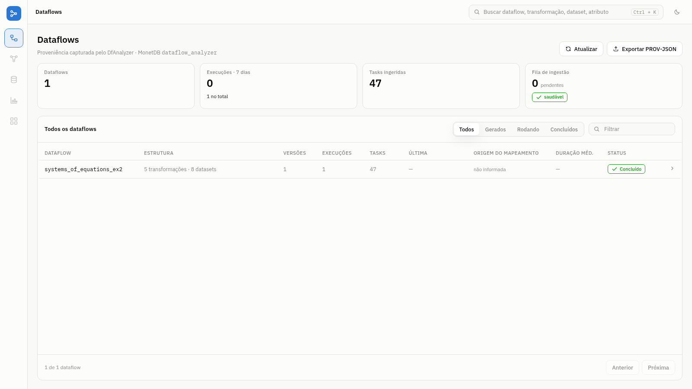
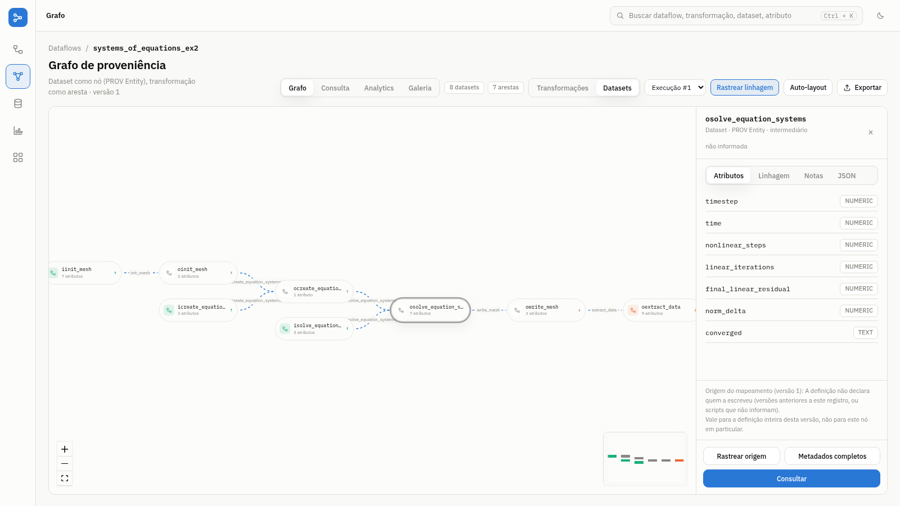
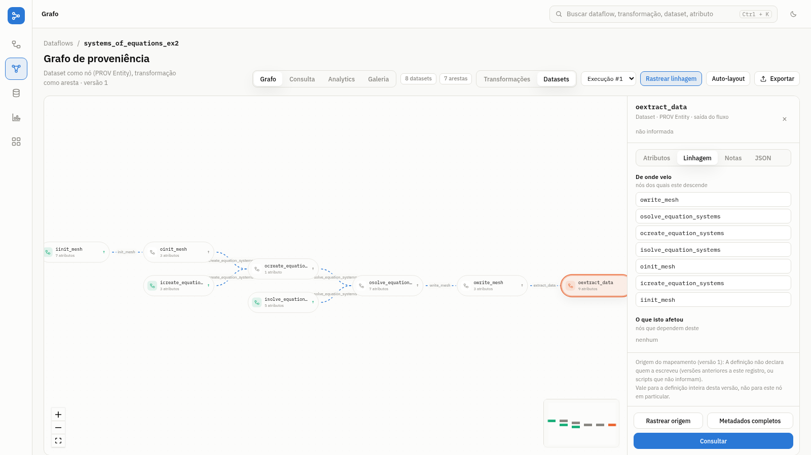
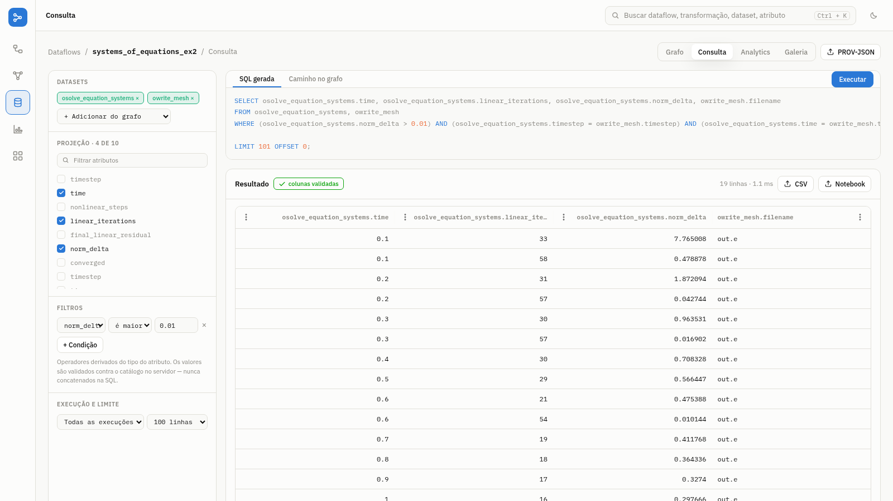

# DfAnalyzer tool

## Contents

1. [Overview](#overview)
2. [Quick start with Docker](#quick-start-with-docker) (Linux, macOS and Windows)
3. [Software requirements](#software-requirements)
4. [Installation](#installation)
5. [An overview of DfAnalyzer components, lib and documentations](#an-overview-of-dfanalyzer-components-and-their-documentations)

- Provenance Data Extractor (PDE)
- DfA Studio and the legacy Dataflow Viewer (DfViewer)
- Query Interface (QI)
- API v2
- Raw Data Extractor and Indexer

6. [Docker images](#docker-images)
7. [Computational Science and Engineering (CSE) applications](#computational-science-and-engineering-applications)

- systems_of_equations_ex2
- prototype_multi-physics

## Overview

This repository presents DfAnalyzer, a dataflow tool for monitoring, debugging, steering, and analyzing dataflow paths of scientific applications.

**Important note**: The components *Provenance Data Extractor* (PDE), *DfA Studio*, *Dataflow Viewer* (DfViewer), and *Query Interface* (QI) are implemented as Web applications and RESTful services in DfAnalyzer project.

## Quick start with Docker

The fastest way to run DfAnalyzer is the `Dockerfile` at the root of this repository. It compiles the RESTful services and DfA Studio from source (running the test suite), installs MonetDB and *dfa-lib-python*, and starts everything with `docker compose`.

| Port | Service |
| --- | --- |
| 22000 | RESTful services, DfA Studio (`/studio`) and legacy DfViewer (`/`) |
| 50000 | MonetDB (`dataflow_analyzer` database, user and password `monetdb`) |

### Linux

1. Install [Docker Engine](https://docs.docker.com/engine/install/) and the Compose plugin, then allow your user to run Docker without `sudo` ([post-installation steps](https://docs.docker.com/engine/install/linux-postinstall/)).
2. Build and start:

   ```bash
   git clone https://github.com/UFFeScience/DfAnalyzer.git
   cd DfAnalyzer
   docker compose up --build
   ```

3. Open <http://localhost:22000/studio>.

### macOS

1. Install [Docker Desktop for Mac](https://docs.docker.com/desktop/setup/install/mac-install/).
2. Run the same commands as on Linux.

The image targets `linux/amd64`, because MonetDB is installed from its amd64 packages. On Apple silicon (M1 and later), Docker Desktop runs it under emulation; keep *Use Rosetta for x86_64/amd64 emulation* enabled in Docker Desktop settings. The first build is slower than on an Intel machine.

### Windows

1. Install [Docker Desktop for Windows](https://docs.docker.com/desktop/setup/install/windows-install/) with the WSL 2 backend.
2. Clone the repository **without** converting line endings, otherwise the shell scripts copied into the image fail with `$'\r': command not found`:

   ```powershell
   git clone -c core.autocrlf=false https://github.com/UFFeScience/DfAnalyzer.git
   cd DfAnalyzer
   docker compose up --build
   ```

   Cloning inside the WSL file system (for example, from an Ubuntu terminal) also avoids the problem and makes the build faster.
3. Open <http://localhost:22000/studio>.

### Using it

Provenance is kept in the `monetdb_data` volume between restarts; `docker compose down -v` deletes it. The container also ships a small Python example that records a two-step dataflow:

```bash
docker compose exec dfanalyzer python3 /opt/example/soma.py
```

Applications running outside the container reach DfAnalyzer at `http://localhost:22000`. *dfa-lib-python* reads the server address from the environment variable `DFA_URL` (default `http://localhost:22000/`).

## Software requirements

The following softwares have to be configured / installed for running this application without Docker.

### RESTful services and DfA Studio

1. [Java](https://adoptium.net/) 8 to build (the `pom.xml` targets Java 8) and Java 8 or later to run.
2. [Apache Maven](https://maven.apache.org/) 3.8 or later. Maven downloads the Node.js version used to build DfA Studio by itself, so Node.js does not need to be installed.
3. [MonetDB](https://www.monetdb.org) as the open-source column-store database system. The Docker image uses MonetDB 11.49 (Dec2023). (Please follow their [user guide](https://www.monetdb.org/documentation/))

### Raw Data Extractor (RDE) and Raw Data Indexer (RDI)

1. [Java](https://www.oracle.com/java/index.html) and [Apache Maven](https://maven.apache.org/), as above.
2. [FastBit](https://sdm.lbl.gov/fastbit/), an efficient compressed bitmap index technology.

### C++ library

1. [GCC](https://gcc.gnu.org/), the GNU Compiler Collection. (Please consider their [installation guide](https://gcc.gnu.org/install/))
2. [curl](https://curl.haxx.se/), a command line tool and library for transferring data with URLs. (Please read their [installation instructions](https://curl.haxx.se/download.html))
3. [boost](https://www.boost.org/), a package of free peer-reviewed portable C++ source libraries.

### Python library

1. [Python](https://www.python.org/), Python language interpreter version >= 3.5.2

## Installation

### RESTful services

DfAnalyzer project can be built by running the following command lines:

```bash
cd DfAnalyzer
mvn clean package
```

`mvn package` also builds DfA Studio into the JAR and runs the test suite; the build fails if a test fails. The JAR file is named *DfAnalyzer-1.0.jar* and it can be found in *./DfAnalyzer/target*.

### Raw Data Extractor and Indexer: RDE and RDI

RDE and RDI can also be compiled in the same way of RESTful services, as follows:

```bash
# Install maven libraries
cd maven
./install_libraries.sh

# RDE
cd ../RawDataExtractor
mvn clean package

# RDI
cd ../RawDataIndexer
mvn clean package
```

### C++ library: *dfa-lib-cpp*

The DfAnalyzer library for the programming language C++ can be built with the following command lines:

```bash
cd library/dfa-lib-cpp
make
```

Then, a static compiled library file, named as *libdfanalyzer.so*, is generated at the directory *library/dfa-lib-cpp/lib*.

### Python library: *dfa-lib-python*

The DfAnalyzer library for the programming language Python can be installed with pip:

```bash
pip install ./library/dfa-lib-python
```

## An overview of DfAnalyzer components and their documentations

### RESTful services

#### Initialization

The project at `DfAnalyzer` contains all web applications and RESTful services provided by our tool. Therefore, the following components are present in this project: *Provenance Data Extractor* (PDE), *DfA Studio*, *Dataflow Viewer* (DfViewer), and *Query Interface* (QI).

Outside Docker, with MonetDB installed, the script `restore-database.sh` creates the database `dataflow_analyzer` in `./data`, and `start-dfanalyzer.sh` starts MonetDB and the RESTful services. We assume the execution of these steps in an Unix-based operating system, as follows:

```bash
cd DfAnalyzer
./restore-database.sh   # first run only
./start-dfanalyzer.sh
```

The services are ready when Spring Boot reports `Tomcat started on port(s): 22000 (http)`. On start, the schema is migrated to the current version, so a database created by an older release keeps its data.

#### Provenance Data Extractor (PDE)

Provenance Data Extractor (PDE) is a DfAnalyzer component responsible for extracting provenance and scientific data from scientific applications. With this purpose, PDE delivers a RESTful API that users can send HTTP request with POST method in order to register data extracted from their applications. These extracted data follows a dataflow abstraction, considering file and data element flow monitoring. Then, PDE stores these extracted data into a provenance database to enable online query processing.

Since our RESTful application has been initialized, users can submit HTTP requests with POST method to PDE for extracting provenance and scientific data. Then, considering the dataflow abstraction followed by DfAnalyzer, users have to introduce a message according to this abstraction. Therefore, PDE provides a set of methods to be present in the HTTP message, as follows:


This web page (http://localhost:22000/dfview/help) can be accessed using a browser after the initialization of DfAnalyzer.

PDE accepts two message formats:

| Format | Dataflow specification | Task record | Used by |
| --- | --- | --- | --- |
| Text (methods above) | `POST /pde/dataflow` | `POST /pde/task` | *dfa-lib-cpp* |
| JSON | `POST /pde/dataflow/json` | `POST /pde/task/json` | *dfa-lib-python* |

Ingestion is asynchronous: PDE answers as soon as the message is queued, and the queue health is shown in DfA Studio. A new dataflow whose dataset tag is already used by another dataflow with different attributes is refused with HTTP 409 (`DATASET_TABLE_CONFLICT`), because dataset tables are named by the dataset tag only. *dfa-lib-python* turns this answer into a `ProvenanceRejectedWarning`.

**Example**

**Dataflow specification**

As an example of dataflow specification to be included in our provenance database, users submit the following HTTP request to PDE, considering a dataflow with one data transformation of our libMesh application (systems_of_equations_ex2):

HTTP message send to the URL `http://localhost:22000/pde/dataflow`

```bash
dataflow(systems_of_equations_ex2)

program(systems_of_equations_ex2::solver.solve(), /root/systems_of_equations_ex2)

dataset(ocreate_equation_systems, {n_dofs}, {NUMERIC})
dataset(isolve_equation_systems, 
            {dt, timesteps, nonlinear_steps, nonlinear_tolerance, nu},
            {NUMERIC, NUMERIC, NUMERIC, NUMERIC, NUMERIC})
dataset(osolve_equation_systems, 
            {timestep, time, nonlinear_steps, linear_iterations, final_linear_residual, norm_delta, converged},
            {NUMERIC, NUMERIC, NUMERIC, NUMERIC, NUMERIC, NUMERIC, TEXT})

transformation(solve_equation_systems, {ocreate_equation_systems, isolve_equation_systems}, {odeduplication}, )
```

**Task record**

After the dataflow specification, provenance and scientific data generated during the execution of scientific applications can be registered in our provenance database. In this case, PDE has to capture HTTP request in the task level (*i.e.*, execution of a data transformation).

For example, the following message should be sent in an HTTP request to the URL `http://localhost:22000/pde/task`

```bash
task(systems_of_equations,  solve_equation_systems, 1, RUNNING)

collection(ocreate_equation_systems, {{ dofs }})
collection(isolve_equation_systems, {{ timestep, time, nonlinear_steps, 
            linear_iterations, final_linear_residual, norm_delta, converged }})

dependency({create_equation_systems}, {1})
```

More details about DfAnalyzer RESTful services can be found [here](https://hpcdb.github.io/armful/dfanalyzer.html).

#### DfA Studio

After the provenance and domain data capture, users can analyze the dataflows stored in our provenance database with DfA Studio, the web interface served at:

```bash
http://localhost:22000/studio # users can also use the hostname for external connections
```

The screenshots below show the dataflow of our libMesh application (*systems_of_equations_ex2*), recorded by its original C++ instrumentation (see [how to reproduce them](#run-against-the-current-dfanalyzer-docker)).

The first page lists the dataflows stored in DfAnalyzer's database, with their structure, versions, executions and tasks, and the state of the ingestion queue.



Clicking on a dataflow opens its provenance graph. In the dataset perspective, datasets are nodes and data transformations are edges; selecting a dataset shows its schema (*i.e.*, the attributes and their types). The graph can also be shown with transformations as nodes, restricted to one execution, and exported as SVG, PNG or [W3C PROV-JSON](https://www.w3.org/submissions/prov-json/).



*Rastrear origem* (trace origin) lists every dataset a node derives from, and every dataset that depends on it. The figure shows the lineage of *oextract_data*.



The *Consulta* (query) tab builds the query for the user: they choose the datasets, the attributes to project and the conditions, and DfA Studio finds the path between the datasets, shows the SQL and the result, and exports it as CSV or as a Jupyter notebook. Values in conditions are validated against the catalog and sent as parameters, never concatenated into the SQL.



The *Analytics* tab shows executions per version, the task timeline and the ingestion health, and *Galeria* profiles datasets and attributes. More details are in [DfAnalyzer/studio/README.md](./DfAnalyzer/studio/README.md).

#### Dataflow Viewer (DfViewer)

The previous interface is still available at `http://localhost:22000`. It lists the dataflow specifications stored in DfAnalyzer's database and shows the dataset perspective of a dataflow, as in the figures below.


#### Query Interface (QI)

Query Interface (QI) is a DfAnalyzer component responsible to get user input, which characterizes and specifies the parameters and properties of the desired data, and then crafts a query responsible to retrieve the necessary datasets, data transformations and data attributes from the database.

Thus, QI generates a SQL-based query according to a specification, where:

* The SELECT clause is populated according to the user-specified projections, representing the data attributes chosen by the user;
* The WHERE clause, which is the most important one from the viewpoint of
  provenance tracing, acts like a filter by selecting and limiting the query to retrieve only the data elements (from datasets) that met a set of specified criteria (conditions);
* and, finally, the FROM clause contains the datasets from where the data attributes specified in the SELECT clause and the conditions specified in the WHERE clause are part of.

Query Interface key function is called <tt>generateSqlQuery</tt>, which
requires the following input arguments that need to be informed by
the users:

* D: the dataflow to be analyzed (it includes dataflow tag and identifier)
* dsOrigins: the datasets to be used as sources for the path finding algorithm;
* dsDestinations: the datasets to be used as destinations (ends) for the path finding algorithm;
* type: the attribute mapping type, which can be either logical (based on domain-specific attributes), physical (based on the identifiers of data transformations) or hybrid;
* projections: data attributes chosen to be part of the SELECT clause;
* selections: set of conditions intended to potentially filter and limit the query results, being part of the WHERE clause;
* dsIncludes: datasets that must be present in the paths found by the path
  finding algorithm;
* dsExcludes: datasets that must not be present in the paths found by the path finding algorithm.

By calling <tt>generateSqlQuery</tt> with the desired arguments, the user is capable of generating and running a SQL code using QI.

Using the RESTful API of DfAnalyzer, users can submit HTTP requests with the POST method to run queries in DfAnalyzer's database. So, these requests have to use the URL `http://localhost:22000/query_interface/{dataflow_tag}/{dataflow_id}` and to add a message, which should contain the query specification as follows:

**Table**: query specification using QI.

Concept | Method (body of the HTTP request) | Additional information
--- | --- | ---
Mapping | mapping(type) | type = PHYSICAL, LOGICAL, HYBRID
Source datasets | source(datasetTags)
Target datasets | target(datasetTags)
Includes | include(datasetTags) | Datasets to be included in the fragment of dataflow path.
Excludes | exclude(datasetTags) | Datasets to be excluded from the fragment of dataflow path.
Projections | projection(attributes) | *attributes* argument defines which attributes will be obtained after query processing, e.g., attributes = {table1.att1;table2.att2}
Selections | selection(conditions) | *conditions* is used to filter only relevant data elements, *e.g.*, table1.att1 > 100

**Example**

Considering our libMesh application (more details below) instrumented to extract provenance and scientific data using DfAnalyzer, users might like to investigate the data element flow from the dataset *osolve_equation_systems* to the dataset *owrite_mesh*, when the nonlinear solver step changed the solution by more than 0.01 (*osolve_equation_systems.norm_delta*). More specifically, they want to know in which times this situation occurs and which mesh file was written. The figure below presents the dataflow fragment analyzed by this query, as drawn by the previous interface.


Based on this dataflow analysis, an HTTP request has to be submitted to our RESTful API with the following URL and message (*i.e.*, HTTP body).

URL:
```
http://localhost:22000/query_interface/systems_of_equations_ex2/1
``` 

Message:

```
mapping(physical)
source(osolve_equation_systems)
target(owrite_mesh)
projection(osolve_equation_systems.time;osolve_equation_systems.norm_delta;owrite_mesh.filename)
selection(osolve_equation_systems.norm_delta > 0.01)
```

As a result, our RESTful API returns the generated SQL, and the result can be downloaded as a CSV file from `http://localhost:22000/downloadCSV`.

The attributes of *oextract_data* (*u*, *v*, *w*, *p*, *x*, *y* and *z*) come from raw data extraction: their values are kept in the FastBit index written by RDE and RDI, and the relational tables keep only the path of that index. Conditions on them, such as `oextract_data.u > 0.01`, therefore return no rows from the database.

#### API v2

DfA Studio is built on a JSON API under `/api/v2` (catalog, provenance graph, lineage, paginated queries, PROV-JSON, analytics and annotations). Its contract is written in OpenAPI and served at `http://localhost:22000/api/openapi.yaml`; the build checks that the contract matches the Java classes.

### DfA-lib in C++ and Python

Since the most of our computational scientists use the programming languages C++ and Python , we develop two libraries to make easier the addition of DfAnalyzer calls in scientific applications, named as dfa-lib-cpp and dfa-lib-python. In this regard, we also deliver a [documentation of dfa-lib in C++ or **dfa-lib-cpp**](https://dfa-lib-cpp-docs.herokuapp.com/) and a [documentation of dfa-lib in Python or **dfa-lib-python**](https://dfa-lib-python-docs.herokuapp.com/).

### RDE and RDI

The user guide of RDE and RDI can be found in their respective directories, as follows:

`RawDataExtractor` ([easy access with this link](./RawDataExtractor))

`RawDataIndexer` ([easy access with this link](./RawDataIndexer))

## Use in scientific applications

### C++ library

When computational specialist needs to configure the *Makefile* of his scientific application, he has to add the following set of directives used by a make build automation tool to generate a target/goal.

```bash
DFANALYZER_DIR 	?= $(DFANALYZER_REPOSITORY)/library/dfa-lib-cpp
LDFLAGS  += -lcurl -L$(DFANALYZER_DIR)/lib -ldfanalyzer
```

Then, he can run the command make for generating an executable file of his application.

# Docker images

The `Dockerfile` at the root of this repository builds DfAnalyzer from source (see [Quick start with Docker](#quick-start-with-docker)).

We also provide a Docker image, named as **dataflow_analyzer**, with the 2019 release of DfAnalyzer tool; its libraries in C++ and Python, known as *dfa-lib*; and two Computational Science and Engineering (CSE) applications, named as *systems_of_equations_ex2* and *prototype_multi-physics*. 

The CSE application *systems_of_equations_ex2* was downloaded from [an example in libMesh website](https://libmesh.github.io/examples/systems_of_equations_ex2.html) and developed using *dfa-lib* in C++, while the application *prototype_multi-physics* used *dfa-lib* in Python. 

DfAnalyzer, its libraries, and CSE applications are stored in directories `DfAnalyzer`, `library`, and `applications` at the path `/dfanalyzer`. 

<a href="https://hub.docker.com/r/vitorss/dataflow_analyzer" target="_blank">
    
</a>

# Computational Science and Engineering applications

Here we present the software requirements and how to run Computational Science and Engineering (CSE) applications *systems_of_equations_ex2* and *prototype_multi-physics*.

## Software requirements

### Systems of Equations - Example 2

1. [HDF5](https://support.hdfgroup.org/HDF5/), a data model, library, and file format for storing and managing data.
2. [PETSc](https://www.mcs.anl.gov/petsc/), the Portable, Extensible Toolkit for Scientific Computation.
3. [libMesh](http://libmesh.github.io/) as a framework for the numerical simulation of partial differential equations using arbitrary unstructured discretizations on serial and parallel platforms.

<a href="https://support.hdfgroup.org/HDF5/" target="_blank">
    
</a>
<a href="https://www.mcs.anl.gov/petsc/" target="_blank">
    
</a>
<a href="http://libmesh.github.io/" target="_blank">
    
</a>

There are also some optional software requirements, if raw data extraction and indexing capabilities are enabled, as follows.

1. [ParaView](https://www.paraview.org/), an open-source, multi-platform data analysis and visualization application.
2. [FastBit](https://sdm.lbl.gov/fastbit/), an efficient compressed bitmap index technology.

### Prototype of Multiphysics Application

1. [FEniCS](https://fenicsproject.org/) as a framework for the numerical simulation of partial differential equations using arbitrary unstructured discretizations on serial and parallel platforms.
2. [DfA-lib-Python](https://dfa-lib-python-docs.herokuapp.com/) A DfAnalyzer library implemented in Python for extracting provenance data, extracting raw data from data sources, and generating indexes of extracted data at runtime based on the usage of DfAnalyzer RESTful services. 
3. [Conda](https://conda.io/docs/index.html), a package dependency and environment management for Python.

<a href="https://fenicsproject.org/" target="_blank">
    
</a>
<a href="https://conda.io/docs/index.html" target="_blank">
    
</a>

## How to run applications

### Systems of Equations - Example 2

#### Source code compilation

Application files are stored in directory `applications/systems_of_equations_ex2` and it has to be compiled. However, it is necessary to define the environment variable `LIBMESH_DIR` with the installation path of libMesh before to run the following command lines:

```bash
cd applications/systems_of_equations_ex2
make
```

#### Environment configuration for raw data extraction and visualization

If visualization and raw data extraction/indexing are enabled in the CSE application (according to the *#define* statements in `systems_of_equations_ex2.C`), it is necessary to configure some environment variables (`PARAVIEW`, `FASTBIT`), since this application will use ParaView tool for extracting raw data from files in [ExodusII](http://prod.sandia.gov/techlib/access-control.cgi/1992/922137.pdf) format and FastBit for applying bitmap indexing technique. Please find below the definition of these variables in our Docker image, besides the environment variable `LIBMESH_DIR`.

```bash
export LIBMESH_DIR=/program/libmesh
export PARAVIEW=/program/paraview
export FASTBIT=/program/fastbit
```

**Important note**: In our Docker image, it is not necessary to compile this application or configure the environment variables.

#### Run application

Then, the second example of Systems of Equations from libMesh website can be executed using DfAnalyzer. In this case, two terminal connections have to be initialized. In the first terminal connection, we will initialize DfAnalyzer RESTful services by running the script `start-dfanalyzer.sh` at `applications/dfanalyzer`. After that, we start the CSE application by running the script `run.sh` at `applications/systems_of_equations_ex2`.

Command lines to the first terminal connection (*DfAnalyzer*):

```bash
cd applications/dfanalyzer
./start-dfanalyzer.sh
```

Command lines to the second terminal connection (*CSE application*):

```bash
cd applications/systems_of_equations_ex2
./run.sh
```

#### Run against the current DfAnalyzer (Docker)

The application compiled in the **dataflow_analyzer** image can also record its provenance in the current DfAnalyzer, which is how the DfA Studio screenshots above were produced. *dfa-lib-cpp* sends its messages to `localhost:22000`, so the application container joins the network of the DfAnalyzer container. Both containers share the `rde` directory, because PDE reads the index files written by the raw data extraction.

```bash
docker build -t dfanalyzer .
docker volume create libmesh-rde

docker run -d --name dfanalyzer -p 22000:22000 \
  -v libmesh-rde:/dfanalyzer/applications/systems_of_equations_ex2/rde \
  -e DFA_URL=http://0.0.0.0:22000 -w /opt/DfAnalyzer \
  --entrypoint sh dfanalyzer start-dfanalyzer.sh

docker run --rm --network container:dfanalyzer \
  -v libmesh-rde:/dfanalyzer/applications/systems_of_equations_ex2/rde \
  -w /dfanalyzer/applications/systems_of_equations_ex2 \
  --entrypoint bash vitorss/dataflow_analyzer:latest ./run.sh
```

The **dataflow_analyzer** image has about 5 GB to download (12 GB on disk). The run takes a few minutes and records 47 tasks over 15 time steps, the same tables and row counts recorded by the DfAnalyzer release shipped in that image.

### Prototype of Multiphysics Application

#### Source code

Application files are stored in directory `applications/prototype_multiphysics_application` divided in three folders each one specific for one execution type, are they: `baseline`and `dfa`. It's necessary to install conda and them execute the following commands.

```bash
cd applications/prototype_multiphysics_application
conda create -n prototype_multiphysics_application -c conda-forge fenics
source activate prototype_multiphysics_application
make init
```

**Important note**: In our Docker image, it is not necessary to install the dependencies above.

#### Run application

Then, the prototype multiphysics application application can be executed using DfAnalyzer.

##### DfAnalyzer

In this case, two terminal connections have to be initialized. In the first terminal connection, we will initialize DfAnalyzer RESTful services by running the script `start-dfanalyzer.sh` at `applications/dfanalyzer`. After that, we start the CSE application by executing the command line `make run-dfa` at `applications/prototype_multiphysics_application`.

Command lines to the first terminal connection (*DfAnalyzer*):

```bash
cd applications/dfanalyzer
./start-dfanalyzer.sh
```

Command lines to the second terminal connection (*CSE application*):

```bash
cd applications/prototype_multiphysics_application
source activate prototype_multiphysics_application
make run-dfa
```

## License Terms

The MIT License (MIT)

Copyright (c) 2019 Federal University of Rio de Janeiro (UFRJ).

Permission is hereby granted, free of charge, to any person obtaining a copy of
this software and associated documentation files (the "Software"), to deal in
the Software without restriction, including without limitation the rights to
use, copy, modify, merge, publish, distribute, sublicense, and/or sell copies of
the Software, and to permit persons to whom the Software is furnished to do so,
subject to the following conditions:

The above copyright notice and this permission notice shall be included in all
copies or substantial portions of the Software.

THE SOFTWARE IS PROVIDED "AS IS", WITHOUT WARRANTY OF ANY KIND, EXPRESS OR
IMPLIED, INCLUDING BUT NOT LIMITED TO THE WARRANTIES OF MERCHANTABILITY, FITNESS
FOR A PARTICULAR PURPOSE AND NONINFRINGEMENT. IN NO EVENT SHALL THE AUTHORS OR
COPYRIGHT HOLDERS BE LIABLE FOR ANY CLAIM, DAMAGES OR OTHER LIABILITY, WHETHER
IN AN ACTION OF CONTRACT, TORT OR OTHERWISE, ARISING FROM, OUT OF OR IN
CONNECTION WITH THE SOFTWARE OR THE USE OR OTHER DEALINGS IN THE SOFTWARE.